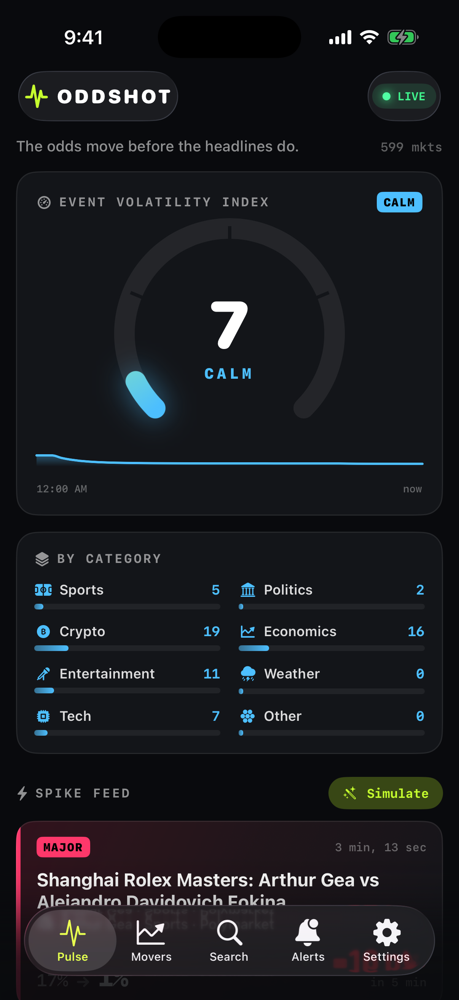

# Oddshot for iOS

SwiftUI companion app for the Oddshot server (see `../CONTRACT.md`). iOS 17+, Swift 6 language mode
(strict concurrency), no third-party packages.



## Build & run

```sh
# 1. Start the backend from the repo root (defaults to http://localhost:8787)
npm start            # or: node server/index.js

# 2. (Re)generate the Xcode project after adding/removing files
cd ios && xcodegen generate && cd ..

# 3. Build for the Simulator
xcodebuild -project ios/Oddshot.xcodeproj -scheme Oddshot \
  -destination 'platform=iOS Simulator,name=iPhone 17 Pro' \
  -derivedDataPath ios/build build

# 4. Install & launch
xcrun simctl boot "iPhone 17 Pro" 2>/dev/null; open -a Simulator
xcrun simctl install booted ios/build/Build/Products/Debug-iphonesimulator/Oddshot.app
xcrun simctl launch booted com.oddshot.app            # add `-initialTab 1..4` to open another tab
```

Or open `ios/Oddshot.xcodeproj` in Xcode and press Run. For a physical iPhone, pick your team under
Signing & Capabilities and set the server URL in **Settings** to your Mac's LAN address
(e.g. `http://192.168.1.20:8787`). ATS allows plain HTTP only for local networking (`NSAllowsLocalNetworking`).

## Tabs

| Tab | What it does |
| --- | --- |
| **Pulse** | Event Volatility Index ring gauge (Calm / Active / Heated / Chaotic), index history, per-category bars, live spike feed over SSE, Simulate button. Haptic + sound on new major spikes. |
| **Movers** | `/api/movers` with Swift Charts sparklines and category filter. Tap for detail: scrubbable probability chart, ⚡ rule marks at spike times, Watch, Open on Polymarket/Kalshi. |
| **Search** | `/api/markets?q=` (debounced) with category chips and one-tap Watch. |
| **Alerts** | Subscription CRUD with persona presets (Photographer, Trader, Fan, Journalist), min-move slider, severity, live-only, keywords, webhook (ntfy/Discord/Slack/generic) + test, Simulate spike. |
| **Settings** | Server URL, connection test (`/api/health`), notification permission, sound/haptics, ntfy setup guide. |

## Layout

```
ios/
  project.yml                 xcodegen spec (source of truth for Oddshot.xcodeproj)
  Oddshot/App/                OddshotApp (scene, lifecycle, BG task), AppModel (@Observable state)
  Oddshot/Models/Models.swift Codable contract types; lenient decoding (missing fields, unknown categories, ml signal)
  Oddshot/Services/           APIClient, SSEClient (URLSession.bytes + reconnect/backoff), Notifications + BackgroundRefresh
  Oddshot/Views/              Theme, Pulse, SpikeCard, Movers, MarketDetail, Search, Alerts, Settings
  scripts/make_icon.swift     regenerates the app icon: swift ios/scripts/make_icon.swift <out.png>
```

## Notifications: what works when

- **App open:** spikes arrive over SSE instantly. When a spike's `matchedSubscriptions` is non-empty, a local
  notification goes out ("Oddshot · +19 pts").
- **App in background:** a `BGAppRefreshTask` (`com.oddshot.app.refresh`) polls `/api/alerts` and notifies about matched
  alerts since the last one seen. iOS decides when this runs (often much less than every 15 min), so it only catches up.
  It does not run in the Simulator unless you trigger it from the debugger.
- **App closed, real-time:** add a webhook of type `ntfy` (`https://ntfy.sh/<your-topic>`) to a subscription and subscribe to
  that topic in the free ntfy app. Native APNs push would need a paid Apple Developer account and server-side push support.
