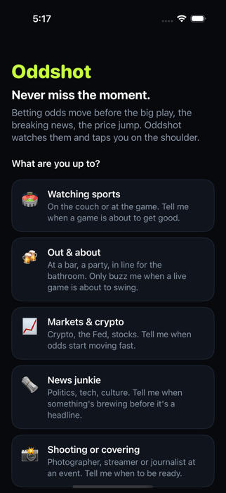
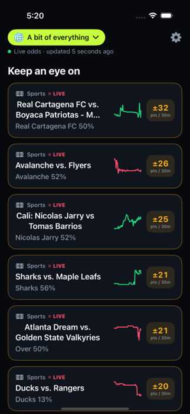
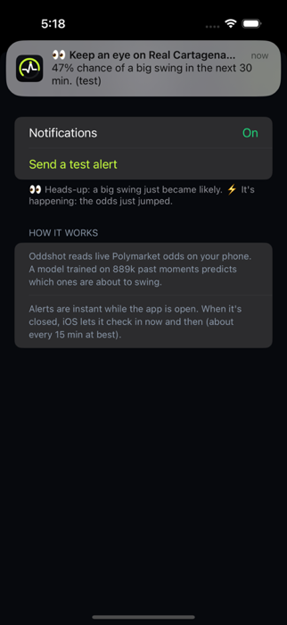

# Oddshot for iPhone

Push notifications that tell you what to keep an eye on. Pick what you're up to, and Oddshot
watches live Polymarket odds on your phone and buzzes you when something is about to happen
(👀 heads-up) or just happened (⚡). No server, no account, no API keys.

  

| Mode | For | Alerts about |
| --- | --- | --- |
| 🏟️ Watching sports | couch or stadium | live games heating up |
| 🍻 Out & about | bar, party, bathroom line | only live games about to swing |
| 📈 Markets & crypto | traders | crypto, Fed, economy |
| 🗞️ News junkie | politics, tech, culture | something brewing before the headline |
| 📸 Shooting or covering | photographers, streamers, journalists | when to be ready |
| 🌐 A bit of everything | anyone | only the biggest moments |

## Run it on your iPhone

1. Plug in your iPhone (first time: unlock it and tap **Trust**; turn on **Settings → Privacy & Security → Developer Mode**).
2. Open `ios/Oddshot.xcodeproj` in Xcode.
3. Pick your iPhone at the top of the window and press **Run** (⌘R).
4. First launch only, on the phone: **Settings → General → VPN & Device Management →** trust your developer certificate.

It's set to sign with team `38LHN9PGZP`. If that isn't yours, choose your team under
**Oddshot target → Signing & Capabilities** (a free Apple ID works). If the bundle ID is taken, change it there too.

## How it works

- Every 20 s it pulls the top 200 Polymarket markets and keeps 6 h of price history (backfilled on launch).
- `Engine/Forecaster.swift` runs the same XGBoost model as the web app (`server/ml/forecaster.json`,
  bundled at build time) to estimate each market's swing over the next 30 minutes.
- **⚡ It's happening:** a 10-minute move bigger than that market normally makes.
- **👀 Heads-up:** the chance of a big swing jumped compared with 15 minutes ago.
- At most one alert per game every 20 minutes and one alert overall every 3 minutes.

**When the app is closed:** iOS only lets apps check in now and then (about every 15 minutes at best),
so alerts are instant only while Oddshot is open. Instant alerts with the app closed would need
Apple's push service (paid developer account) plus a server.

## Files

```
Oddshot/App/      OddshotApp (lifecycle, background refresh), Notifier (local notifications)
Oddshot/Engine/   Market (Polymarket client), Mode (who you are + alert wording), Forecaster, Watcher (the loop)
Oddshot/Views/    Onboarding, Home, Settings, Theme
OddshotUITests/   first-run walkthrough with screenshots
project.yml       xcodegen spec: run `xcodegen generate` after adding files
```
