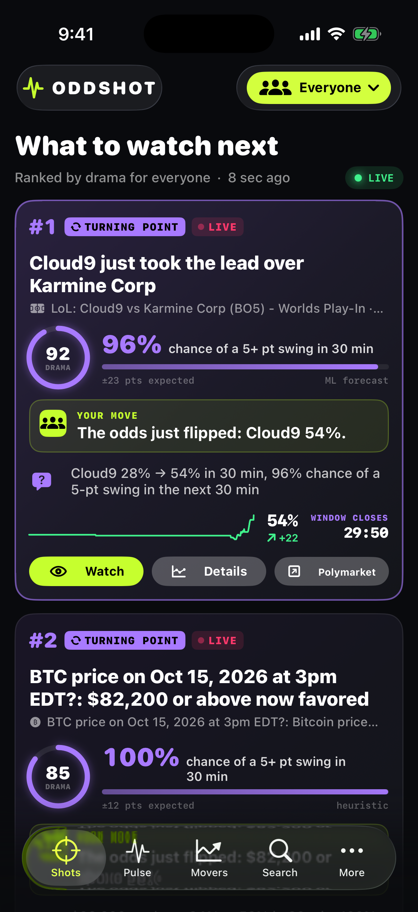

# Oddshot for iOS

SwiftUI companion app for the Oddshot server (see `../CONTRACT.md`). iOS 17+, Swift 6 language mode
(strict concurrency), no third-party packages.

 

## Build & run

```sh
# 1. Start the backend from the repo root (defaults to http://localhost:4317)
npm start            # or: node server/index.js

# 2. (Re)generate the Xcode project after adding/removing files
cd ios && xcodegen generate && cd ..

# 3. Build for the Simulator
xcodebuild -project ios/Oddshot.xcodeproj -scheme Oddshot \
  -destination 'platform=iOS Simulator,name=iPhone 17 Pro' \
  -derivedDataPath ios/build build

# 4. Install & launch
xcrun simctl boot "iPhone 17 Pro" 2>/dev/null; open -a Simulator
xcrun simctl install booted ios/build/Build/Products/Debug-iphonesimulator/Oddshot.app
xcrun simctl launch booted com.oddshot.app            # add `-initialTab 0..5` (0 Shots, 1 Pulse, 2 Movers, 3 Search, 4 Alerts, 5 Settings);
                                                      # `-skipNotificationPrompt YES` suppresses the permission alert for screenshots
```

Or open `ios/Oddshot.xcodeproj` in Xcode and press Run. For a physical iPhone, pick your team under
Signing & Capabilities and set the server URL in **Settings** to your Mac's LAN address
(e.g. `http://192.168.1.20:4317`). ATS allows plain HTTP only for local networking (`NSAllowsLocalNetworking`).

## Tabs

| Tab | What it does |
| --- | --- |
| **Shots** (v2, first tab) | Recommender: ranked Shot cards from `/api/shots?persona=`, refreshed on SSE `shots`, pull-to-refresh, and a 45 s fallback poll. Each card shows the kind badge (tension / turning point / decisive / closing / upcoming / momentum, each with its own color and icon), headline, a forecast meter ("64% chance of a 5+ pt swing in 30 min"), a drama score ring, a live window countdown (`TimelineView`), the selected persona's tip, the "why" line, a sparkline, and Watch / Details / Open-on-venue buttons. You can also swipe right to Watch or left for Details/Open, or long-press for a menu. Rank changes animate and show ▲/▼ arrows. The persona picker (Photographer / Trader / Fan / Journalist / Everyone) lives in the toolbar and is stored in `@AppStorage("shotPersona")`. |
| **Pulse** | "While you were away" Briefing card (`/api/briefing`), Stories carousel (`/api/stories`), Event Volatility Index ring gauge, index history, per-category bars, and a live feed of spikes and Insights (`/api/insights` + SSE `insight`) with an All / Spikes / Insights segmented filter. Each insight type has its own icon. Haptic + sound on new major spikes. |
| **Movers** | `/api/movers` with Swift Charts sparklines and category filter. Tap for detail: scrubbable probability chart, ⚡ rule marks at spike times, a **Next 30 min** forecast (`/api/markets/:id/forecast`) with driver bars, that market's insights, Watch, Open on Polymarket/Kalshi. |
| **Search** | `/api/markets?q=` (debounced) with category chips and one-tap Watch. |
| **Alerts** | Subscription CRUD with persona presets (Photographer, Trader, Fan, Journalist), min-move slider, severity, live-only, keywords, webhook (ntfy/Discord/Slack/generic) + test, Simulate spike. |
| **Settings** (under *More*) | Server URL, connection test (`/api/health`), notification permission, sound/haptics, ntfy setup guide. |

## Roles & recommendations (v3)

- **Role switcher:** the lime pill in the toolbar of every tab (Photographer / Trader / Fan / Journalist / Everyone).
  It's stored in `@AppStorage("shotPersona")` and shared app-wide. Switching re-ranks Shots and re-words every card.
- **Recommendation panel** on spike, shot and insight cards, plus market detail. It comes from each item's `recommendations[role]`,
  falling back to `general`. It shows the headline, action, a 3-step confidence meter and an expandable "Why?" reasoning list.
  Trader cards show a disclaimer. A badge shows **CLAUDE** or **RULES**. SSE `recommendation` events
  (`{targetId, role, recommendation}`) replace the matching card's text in place. Market detail also calls
  `/api/markets/:id/recommendation?role=` and `/api/markets/:id/context`.
- **Live context chips:** for games, league, in-play/final, score, period and clock, the situation ("1st & Goal at KC 4"), and a pulsing
  **IMMINENT** badge. For assets, the spot price and 5m/1h change.
- **Volatility spikes** (`kind == "volatility"`) have a violet VOLATILITY badge, a dashed violet border, and show "3.4× vol" instead of points.
- **Notifications** use the active role's recommendation, e.g. "📸 Chiefs 1st & goal at the 4 — get the end-zone shot", with the action
  (plus any disclaimer) as the body. Without a recommendation they fall back to the v1/v2 wording.

All v3 fields are optional. Payloads without them render exactly as before.

## Layout

```
ios/
  project.yml                 xcodegen spec (source of truth for Oddshot.xcodeproj)
  Oddshot/App/                OddshotApp (scene, lifecycle, BG task), AppModel (@Observable state)
  Oddshot/Models/Models.swift Codable contract types; lenient decoding (missing fields, unknown categories, ml signal)
  Oddshot/Models/V2Models.swift Shot, Forecast, Insight, Story, Briefing, LenientList (skips bad elements, accepts wrapped arrays)
  Oddshot/Models/V3Models.swift Recommendation(Set), LiveContext (game/asset), SSE recommendation event, role emoji
  Oddshot/Services/           APIClient, SSEClient (URLSession.bytes + reconnect/backoff), Notifications + BackgroundRefresh
  Oddshot/Views/              Theme, V2Theme, Shots, ShotCard, InsightViews (Insight/Briefing/Story), V3Views (RoleMenu,
                              RecommendationView, ContextChips), Pulse, SpikeCard,
                              Movers, MarketDetail, Search, Alerts, Settings
  scripts/make_icon.swift     regenerates the app icon: swift ios/scripts/make_icon.swift <out.png>
```

## Notifications: what works when

- **App open:** spikes arrive over SSE instantly. When a spike's `matchedSubscriptions` is non-empty, a local
  notification goes out ("Oddshot · +19 pts").
- **Insights (v2):** a notable or major `insight` from SSE posts a local notification when it matches one of your subscriptions,
  using the server's `matchedSubscriptions` if it sends them, otherwise a client-side mirror of the matching rules. You can turn this off in Settings.
- **Top shots (v2):** when a shot newly enters the top 3 for your chosen persona, you get a notification, at most one every 10 minutes.
  The baseline resets when you switch persona. You can turn this off in Settings.
- **v2 endpoints missing:** if `/api/shots` returns 404 the Shots tab says so and offers a Retry button. If Insights, Stories, Briefing or Forecast
  are missing, those sections are hidden or show an inline note. The rest of the app keeps working.
- **App in background:** a `BGAppRefreshTask` (`com.oddshot.app.refresh`) polls `/api/alerts` and notifies about matched
  alerts since the last one seen. iOS decides when this runs (often much less than every 15 min), so it only catches up.
  It does not run in the Simulator unless you trigger it from the debugger.
- **App closed, real-time:** add a webhook of type `ntfy` (`https://ntfy.sh/<your-topic>`) to a subscription and subscribe to
  that topic in the free ntfy app. Native APNs push would need a paid Apple Developer account and server-side push support.
